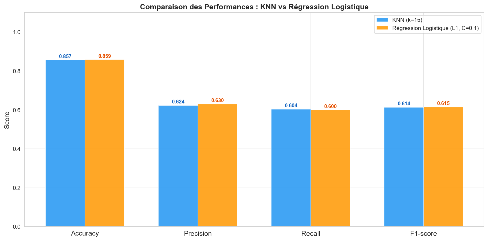
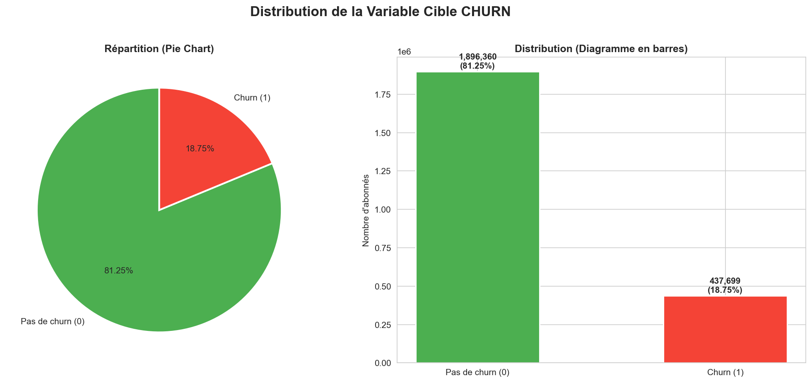
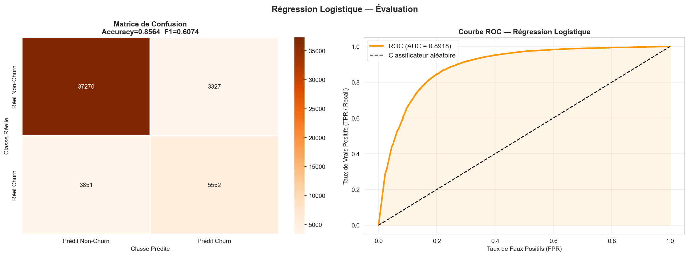

# Prédiction du churn d'abonnés télécom

Identifier à l'avance les abonnés d'un opérateur télécom susceptibles de partir, pour cibler les actions de rétention. Projet réalisé dans le cadre de la Licence IT, IA & Big Data (publié avec l'accord de l'enseignant).

## Résultats

| Modèle | Accuracy | Précision | Rappel | F1 | AUC-ROC |
|---|---|---|---|---|---|
| KNN (k = 15) | 0,8570 | 0,6239 | 0,6038 | 0,6137 | — |
| **Régression logistique (L1, C = 0,1)** | **0,8586** | **0,6303** | 0,6002 | **0,6149** | **0,8918** |

**Modèle retenu : la régression logistique.** Performances équivalentes au KNN, mais elle donne une probabilité de départ par client, des coefficients interprétables et une prédiction quasi instantanée sur 2,3 M d'abonnés.



## Données

- 2 334 059 abonnés, 19 variables (montant et fréquence de recharge, revenu, ARPU, volume data, régularité, région, ancienneté…).
- Cible `CHURN` déséquilibrée : 81,25 % restent, **18,75 % partent**.
- Le fichier `dataset_churn.csv` n'est pas inclus dans le dépôt (taille). Placez-le dans `data/` pour relancer le notebook.



## Démarche

1. **Exploration** : statistiques descriptives, distribution de la cible, boxplots bivariés. La régularité d'usage est la variable la plus discriminante.
2. **Préparation** : valeurs manquantes (moyenne / « Inconnu »), séparation 80/20 stratifiée, `StandardScaler`.
3. **Régression linéaire sur REVENUE** : R² = 1, identifié comme un artefact (corrélation de 0,9999 avec ARPU_SEGMENT) et non comme une performance.
4. **KNN** : k testé de 1 à 20, choisi sur le F1-score plutôt que l'accuracy à cause du déséquilibre.
5. **Régression logistique** : régularisation L1 et L2 avec C de 0,001 à 100.
6. **Comparaison et recommandation métier.**



## Lancer le projet

```bash
git clone https://github.com/DOWOU-Issa/churn-prediction-telecom.git
cd churn-prediction-telecom
pip install -r requirements.txt
# placer dataset_churn.csv dans data/
jupyter notebook notebooks/churn_prediction.ipynb
```

## Limites et pistes

- Rappel autour de 60 % : 4 départs sur 10 ne sont pas détectés.
- Pistes : pondération des classes ou SMOTE, ajustement du seuil de décision selon le coût d'un client perdu, modèles d'ensemble (Random Forest, Gradient Boosting) avec interprétation SHAP.

## Auteur

DOWOU Issa · [Portfolio](https://github.com/DOWOU-Issa) · [LinkedIn](https://www.linkedin.com/in/issa-dowou-4abbaa3a1)
